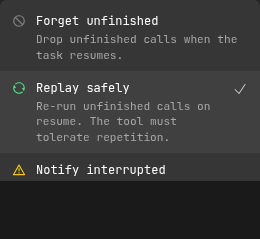
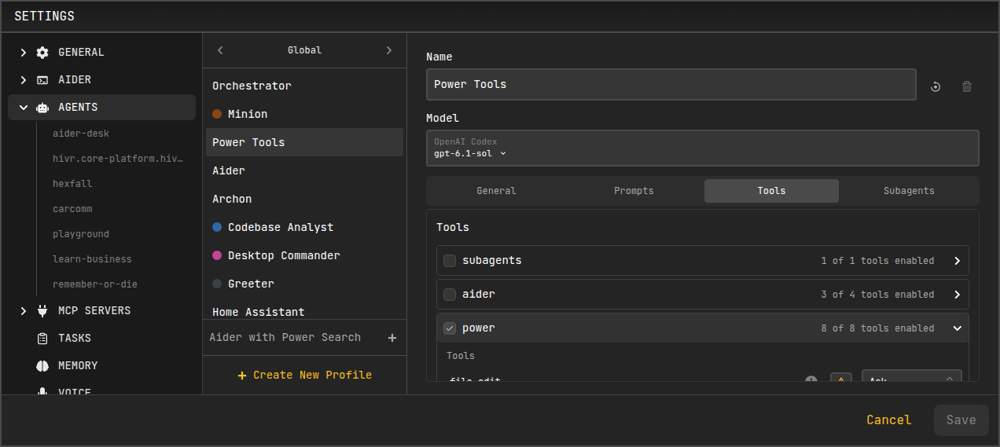
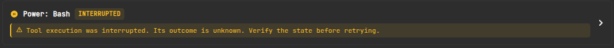
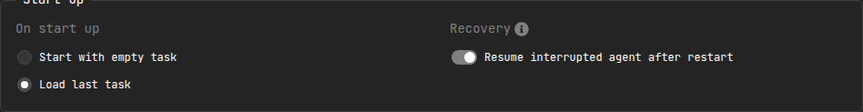

# Task Recovery

Agent runs can take a long time and perform real work along the way — editing files, running commands, calling tools, and spawning subagents. If AiderDesk is closed or crashes mid-run, that progress should not be lost or silently repeated. **Task Recovery** persists each step of an agent run as it happens, so an interrupted run can be resumed from where it stopped the next time the project opens.

## How It Works

While an agent is running, AiderDesk checkpoints its execution to the application database: the assistant's streamed response, every tool call, and the finalized result of each tool are recorded as they complete. Because these checkpoints are written durably as the run progresses, they survive an unexpected shutdown — even a hard crash or forced process kill.

When the project is opened again, AiderDesk looks for any interrupted runs and resumes them:

- **Completed work is preserved.** Tool calls that had already finished keep their results instead of being thrown away or re-executed.
- **Unfinished work is handled per the tool's recovery mode** (see below). Read-only and idempotent operations can be re-run automatically; other operations are not repeated.
- **Subagents resume under their original identity** rather than being spawned again as duplicates.

To protect against a run that repeatedly fails on startup, recovery is limited to **two attempts** for a given interrupted operation. If the same step fails a second time, it is reported as interrupted and skipped on the next start, so a problematic run can never prevent the app from launching.

## Recovery Modes

Not every tool is safe to run twice. A file read can be repeated harmlessly, but a shell command or a file edit should not be silently re-executed. Each tool therefore has a **recovery mode** that controls what happens to an unfinished call when a task resumes:

| Mode | Behavior |
| --- | --- |
| **Replay safely** | Re-run unfinished calls on resume. The tool must tolerate repetition. |
| **Notify interrupted** | Report an unknown outcome so the model verifies the state before retrying, instead of re-running the call. |
| **Forget unfinished** | Drop unfinished calls when the task resumes. |

Sensible defaults are applied out of the box:

- **Replay safely:** read-only and search tools, `fetch`, all Todo tools, memory update and delete, task delete, and Aider's add/drop context file tools. These operations tolerate repetition, including deleting a memory or task that is already absent.
- **Notify interrupted:** `file_write`, `file_edit`, `bash`, memory store, task create/run prompt, skill activation, Aider's run prompt, and programmatic tool calls. These are never re-executed automatically.
- **Forget unfinished:** tools without a declared recovery mode or built-in default, unless overridden in the agent profile.

### Configuring Recovery Modes

You can adjust the recovery mode for individual tools in **Settings → Agents → Tools**. Each tool row shows a small recovery-mode selector; open it to pick how that tool should be treated on recovery.

## Recovery in the Conversation

When a run resumes, AiderDesk makes the outcome of each interrupted tool explicit in the conversation so both you and the model understand what happened. Instead of a normal tool result, an interrupted call shows a recovery notice describing its state — for example that execution was interrupted with an unknown outcome, or that it completed but its result could not be finalized.

These notices are instructions to the model: they tell it to verify the current state before repeating an operation, rather than blindly retrying something that may already have taken effect.

## Enabling and Disabling Automatic Resume

Automatic resume is controlled in **Settings → General → Start Up → Recovery**.

- **Resume interrupted agent after restart** (default: **on**) — when enabled, an agent run that was interrupted by an app close or crash is automatically resumed the next time the project opens. When disabled, interrupted runs are left as they are and are not resumed on their own.

Turning this off does not discard recovery data for the current run; it only prevents AiderDesk from resuming automatically on the next launch.

## Limitations

Interrupted execution state is stored in the **application-local database**, not inside the portable task directory. This has a few consequences:

- Copying, exporting, duplicating, or restoring only a task's files does **not** transfer its pending execution state. Such a task keeps its finalized conversation but cannot resume the original interrupted run.
- Moving or renaming a project changes how its recovery data is looked up, so an active interrupted run does not follow the project to a new location.
- A complete same-identity backup of an in-progress task requires both the task files and the application database.

For finished conversations and context, the task directory remains the source of truth — only the state of an *unfinished* run lives in the database.

## Related Features

- **[Managing Tasks](../agent-mode/managing-tasks.md)** - How tasks are created, persisted, and resumed
- **[Handoff and Compaction](../core/handoff-and-compaction.md)** - How long conversations are summarized and carried forward
- **[Subagents](../agent-mode/subagents.md)** - Delegated agent runs that recover under their parent's identity
